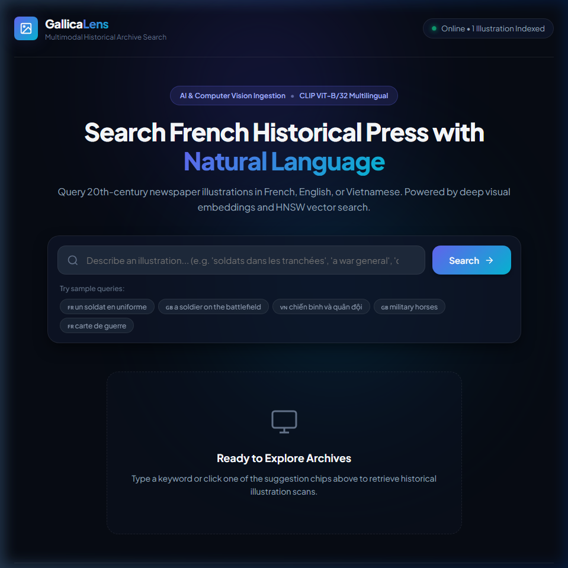
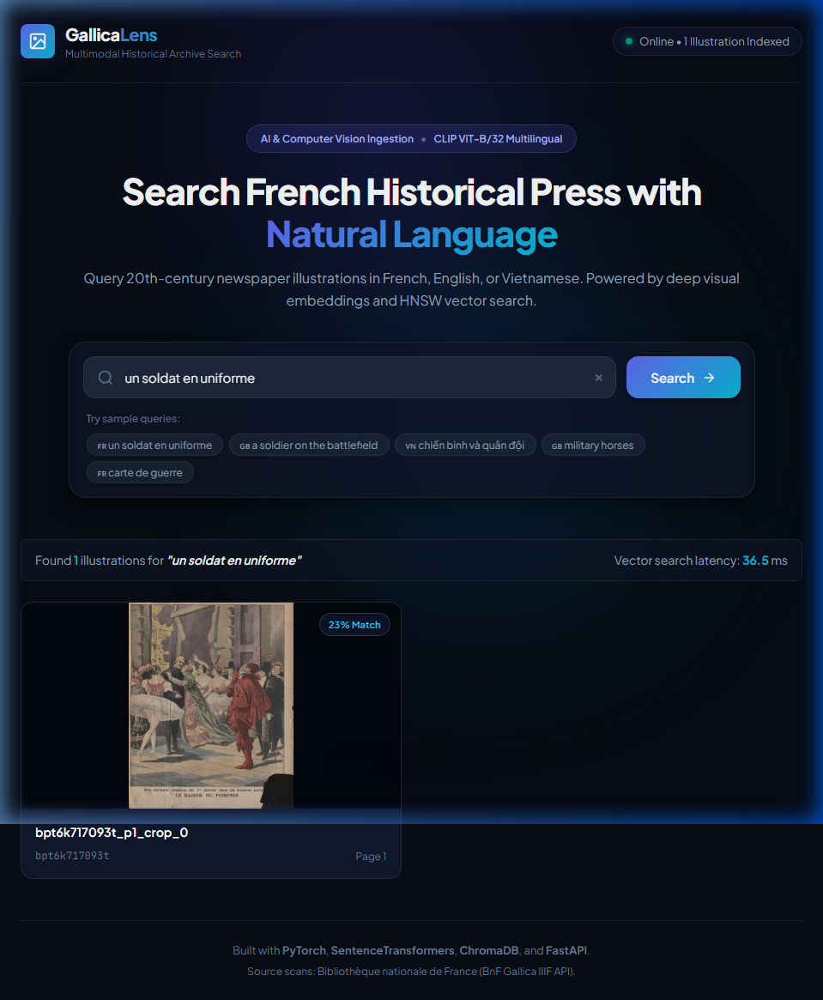
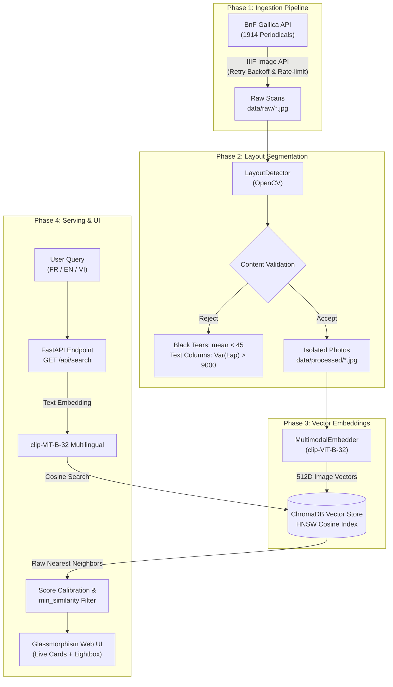

# GallicaLens: Multimodal Semantic Search for Historical Archives

[](https://www.python.org/)
[](https://fastapi.tiangolo.com/)
[](https://pytorch.org/)
[](https://www.trychroma.com/)
[](https://opencv.org/)
[](https://github.com/astral-sh/ruff)
[](https://mypy-lang.org/)
[](https://docs.pytest.org/)

> **An end-to-end AI & Data Engineering platform to discover, segment, and semantically search centuries of historical newspaper illustrations in natural language (French, English, Vietnamese).**

---

## Visual Demo

<p align="center">
  
  
</p>

*Left: GallicaLens search portal with multilingual chips and live status. Right: Sub-40ms semantic search retrieving 1914 WWI illustrations from natural language text.*

---

## 1. Problem Overview & Core Innovation

The **Bibliothèque nationale de France (BnF) Gallica** archive hosts millions of digitized historical newspapers (e.g., *Le Miroir*, *Le Figaro*, *Le Petit Journal*). However:
1. **No Illustration Tags**: Archives only provide page-level metadata and raw OCR text. Photographs, military engravings, and political cartoons cannot be found via keyword search.
2. **Dense Printed Layouts**: Early 20th-century periodicals interleave multi-column text, ornate banners, scanner borders, and paper tears. Naive contour detection erroneously tags dense text blocks as illustrations.
3. **Cross-Lingual Gap**: Users searching in English or Vietnamese cannot easily find French historical materials without cumbersome manual translation.

### The Solution: GallicaLens
- **Content-Aware Computer Vision**: Custom `LayoutDetector` segments page scans using Otsu thresholding, morphological closing, and **statistical tonal filtering** to discard text columns and black margin tears.
- **Multimodal Embedding Space**: Pre-trained multilingual CLIP (`clip-ViT-B-32-multilingual-v1`) maps cross-lingual queries (FR, EN, VI) and cropped images into a **shared 512-dimensional latent hypersphere**.
- **Score Calibration & Confidence Thresholding**: Mitigates the CLIP modality gap ("cone effect") via piecewise linear calibration to suppress false-positive background noise.
- **Persistent HNSW Vector Search**: ChromaDB stores 512D embeddings with sub-40ms cosine similarity nearest-neighbor retrieval.
- **Modern Web Application**: Glassmorphism dark-mode UI with live system health, latency metrics, and interactive modal lightbox.

---

## 2. System Architecture



---

## 3. Key Technical Deep-Dives

### A. Layout Analysis & Statistical Content Filtering
Historical scans contain ink stains, torn edges, and dense columns of text. While geometric rules (aspect ratio, minimum area) isolate rectangles, they cannot distinguish a block of small text from a photograph.

GallicaLens implements a multi-metric filter `is_valid_illustration()`:

1. **Black Blot / Scanner Margin Rejection**:
   $$\mu = \frac{1}{N}\sum I_i, \quad R_{\text{black}} = \frac{1}{N}\sum \mathbb{I}(I_i < 40)$$
   Crops with $\mu < 45$ or $R_{\text{black}} > 40\%$ are immediately dropped.
2. **Text Column vs. Continuous-Tone Photograph Filter**:
   - **Tonal Distribution**: Printed text is strictly bimodal (ink glyphs on paper white). True photographs contain continuous halftones with a high midtone ratio $R_{\text{mid}} = \frac{1}{N}\sum \mathbb{I}(60 \le I_i \le 200)$.
   - **Laplacian Variance**: Discrete 2D Laplacian $\nabla^2 I$ measures edge frequency. High-frequency text transitions yield extreme variance ($\mathrm{Var}(\nabla^2 I) > 9000$), whereas continuous photos stay within $1500 - 4000$.
   - **Decision Rule**:
     $$\text{Reject if } (R_{\text{mid}} < 0.40 \text{ and } R_{\text{white}} > 0.25) \text{ or } (\mathrm{Var}(\nabla^2 I) > 9000 \text{ and } R_{\text{mid}} < 0.50)$$

### B. Mathematical Score Calibration
Multimodal models project image and text embeddings into a 512-dimensional unit hypersphere $\mathbb{S}^{511}$. Due to the cross-modal **modality gap** (cone effect), unrelated text and images exhibit a background baseline similarity around $S \approx 0.18 - 0.21$.

To provide intuitive percentages and eliminate low-relevance noise, GallicaLens applies piecewise calibration:

$$C(S) = \begin{cases} 
0.0 & \text{if } S \le 0.20 \\
1.0 & \text{if } S \ge 0.30 \\
\frac{S - 0.20}{0.10} & \text{otherwise}
\end{cases}$$

Queries below the confidence threshold (`min_similarity=0.20`, e.g. unrelated queries like `"fish"`) cleanly return `count: 0` instead of displaying deceptive matches.

---

## 4. Tech Stack & Engineering Standards

| Domain | Technology | Role |
|---|---|---|
| **Language & Tooling** | Python 3.11, `uv`, Git pre-commit | Modern dependency management and Git hooks |
| **Multimodal ML** | `sentence-transformers`, `clip-ViT-B-32-multilingual-v1` | 512D text-image cross-modal embeddings |
| **Vector Database** | ChromaDB (`PersistentClient`) | HNSW cosine similarity vector index |
| **Computer Vision** | OpenCV (`cv2`), NumPy | Layout analysis, Otsu binarization, Laplacian variance |
| **API Backend** | FastAPI, Uvicorn, Pydantic v2 | High-performance asynchronous REST API |
| **Frontend UI** | HTML5, Vanilla CSS3 (Glassmorphism), JavaScript | Responsive dark mode, zero frontend build overhead |
| **Data Collection** | `curl-cffi`, IIIF Image API, BeautifulSoup4 | Anti-bot compliant historical archive harvesting |
| **Code Quality** | Ruff, Mypy (`strict=True`), Pytest | 100% typing safety, sub-second linting, 30 tests |

---

## 5. Quickstart Guide

### 1. Clone & Set Up Environment
```bash
git clone https://github.com/TrAChg/news-search.git
cd news-search

# Install dependencies using uv (recommended)
uv sync
```

### 2. Run the Ingestion Pipeline
Harvest and segment historical 1914 WWI periodicals (*Le Miroir*):
```bash
# Ingest curated 1914 wartime batch
python scripts/run_pipeline.py --batch --max-pages 8

# Or ingest an arbitrary Gallica ARK issue
python scripts/run_pipeline.py --ark "ark:/12148/bpt6k717093t" --max-pages 8
```

### 3. Compute Embeddings & Index into ChromaDB
```bash
python scripts/index_illustrations.py
```

### 4. Launch the Web Application
```bash
uv run uvicorn src.api.app:app --host 127.0.0.1 --port 8000 --reload
```
Open your browser to:
- **Web Portal**: [http://127.0.0.1:8000](http://127.0.0.1:8000)
- **Interactive Swagger Docs**: [http://127.0.0.1:8000/docs](http://127.0.0.1:8000/docs)
- **Health Check**: [http://127.0.0.1:8000/api/health](http://127.0.0.1:8000/api/health)

---

## 6. Testing & Code Quality

The repository enforces strict code quality through pre-commit hooks and automated test suites:

```bash
# Run 30 unit & integration tests
uv run pytest

# Check strict typing with mypy
uv run mypy src

# Run fast linter & code formatter
uv run ruff check src tests scripts
uv run ruff format --check .
```

---

## 7. Author

**Tran Chung**  
*Engineering Student in Computer Science (AI & Data Engineering)*  
[Université de Technologie de Compiègne (UTC)](https://www.utc.fr/) — Compiègne, France  
[GitHub Profile](https://github.com/TrAChg)
